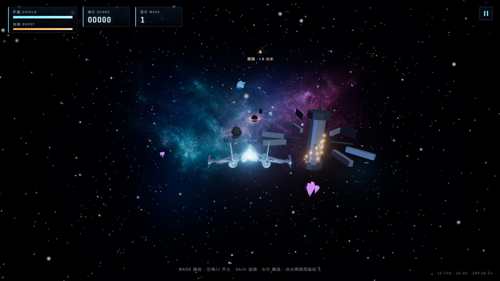
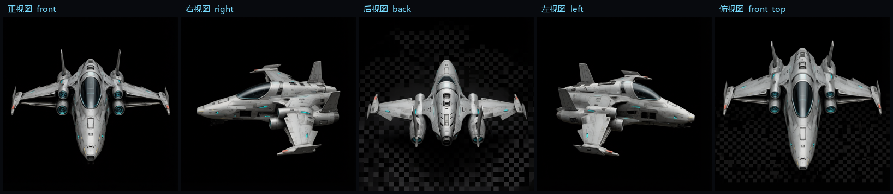
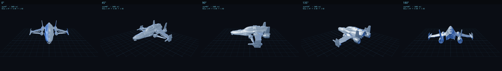
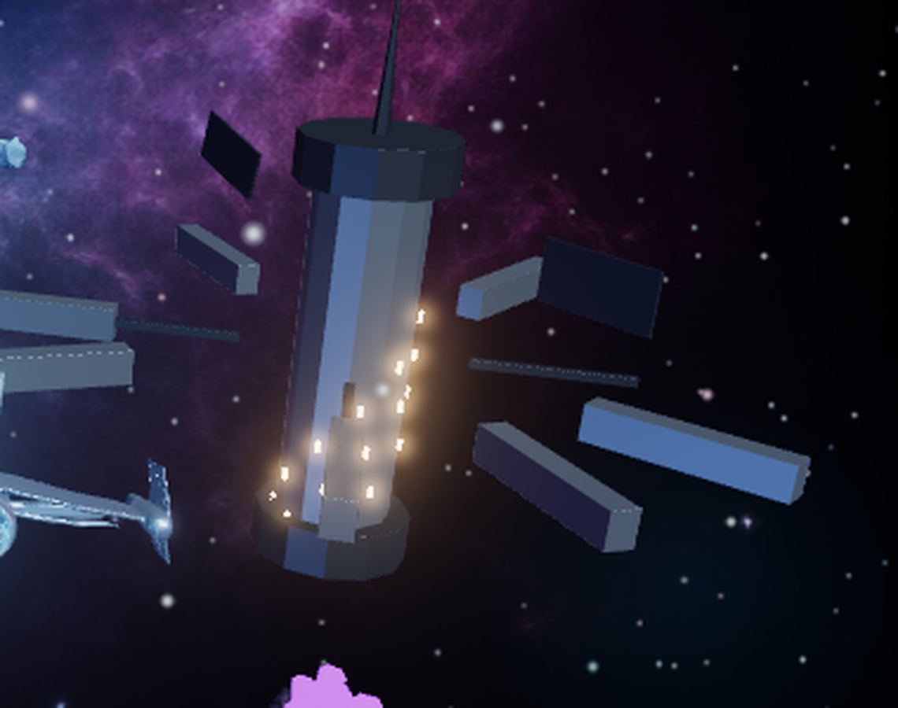
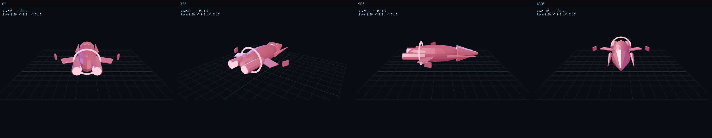

# 星弧 · STAR ARC

一个用 **Three.js** 做的第三人称太空射击垂直切片（vertical slice）：三次元飞行、双管机炮、陨石与无人机波次、受击反馈、死亡重开。

**零美术资源**——飞船、陨石、敌机、星空、星云、爆炸、音效全部由代码程序化生成。



---

## 快速开始

```bash
npm install
npm run dev      # http://127.0.0.1:5173
```

生产构建：

```bash
npm run build    # 输出到 dist/
npm run preview  # 本地预览构建产物
```

> `dist` 使用相对路径（`base: './'`），可以直接丢到任意静态托管。

## 操作

### PC

| 输入 | 动作 |
|---|---|
| `W` `S` / `↑` `↓` | 俯仰（抬头 / 低头） |
| `A` `D` / `←` `→` | 偏航（左右转） |
| `Q` `E` | 横滚 |
| `空格` / `J` | 开火（按住连发） |
| `Shift` | 加力冲刺 |
| 点击画面 | 进入鼠标飞行模式（鼠标转向，`Esc` 退出） |
| `Esc` / `P` | 暂停菜单（继续 / 重开 / 退出到主菜单） |
| `M` / `R` / `G` | 静音 / 重开 / 调参面板 |

### 移动端

- **左半屏任意位置按下**：浮动虚拟摇杆（手指按哪，摇杆就在哪）
- **右下 `FIRE`**：按住连发；右半屏任意处按下也能开火
- **`BOOST`**：加力

> 触屏设备自动显示触控层；桌面调试可用 `?touch=1` 强制开启。

## 玩法现状

- ✅ **可飞入的地标**：黑洞（吸进去 → 白闪穿越）/ 银河（飞进星云内部），屏幕边缘有导航箭头 + **光年**距离
- ✅ **星区递进**：每 1.8 光年一处地标，穿越/进入后换天、清场、抬高波次
- ✅ **暂停菜单**：右上角暂停键 / `Esc`，可继续、重开、退出到主菜单
- ✅ **360° 自由飞行**：四元数姿态，能翻筋斗、横滚、倒飞
- ✅ **加力冲刺**：消耗能量条（按 `Shift` / 手机 `BOOST`），冲刺时视野拉伸
- ✅ **开局教学**：进游戏先给一张操作说明，PC / 手机自动切换
- ✅ **道具**：无敌（青色护盾罩）、反弹（敌弹反射回敌人）、修复（回血）
- ✅ **动态背景**：银河 / 黑洞 / 星云团，每 46 秒淡入淡出切换，缓慢自转
- ✅ **五类障碍物**：岩石（大块会碎成小块）、冰晶、晶簇、**金属残骸**（船体板）、**玄武岩**（黑、厚、伤害高）
- ✅ **敌机用 Blender 建模**：纺锤机身 + 后掠翼 + 双发动机 + 发光环，不再是八面体
- ✅ 陨石密度调稀（1.25s 一颗，最快不低于 0.62s），留出反应距离
- ✅ **背景只放星云**（蓝紫 / 青紫 / 金红三种色调轮换），避免和地标叠成"两个天体糊在一起"
- ✅ 无限波次，每 22 秒一波，难度随波次上升
- ✅ 无人机会追到机头前方盘旋并反击
- ✅ 三套输入共用一套飞行参数：键盘 / 鼠标锁定 / 触屏
- ⬜ BOSS、多种武器、排行榜（见 [开发方案](docs/开发方案.md) 第 9 节）

## 美术素材（本地 ComfyUI 生成）

`public/art/` 下的图是**本地 ComfyUI**生成的，脚本在 [`tools/`](tools)：

| 文件 | 用途 | 用的工作流 |
|---|---|---|
| `bg_galaxy` / `bg_blackhole` / `bg_nebula` | 天球背景 | Qwen-Image 2.1 Turbo t2i |
| `menu_art` | 主菜单插画 | 同上 |
| `tex_rock` / `tex_ice` / `tex_crystal` | 三类障碍物表面贴图 | 同上 |
| `icon_shield` / `icon_reflect` / `icon_repair` | 道具图标（纯黑底，UI 用 `mix-blend-mode: screen` 抠黑） | 同上 |
| `ship_portrait` | 暂停菜单的座机肖像 | 切换角度工作流（Qwen-Image-Edit 2511 + 多角度 LoRA），亮度抠图 |

### 多角度三视图



`tools/gen_turnaround.py` 会把 ComfyUI 的 **UI 格式工作流**（`user/default/workflows/切换角度.json`）转成 API 格式再提交，
用 `<sks> front view / right side view / back view ...` 这类提示词把同一艘飞船转出一圈视图。产物在 `docs/art/`。

```bash
python tools/gen_assets.py --only ...        # 出基础图
python tools/gen_turnaround.py --image public/art/base_ship.jpg
```

### 图生 3D（Hunyuan3D 2.0 → GLB）



```bash
python tools/gen_3d.py --image public/art/ship_input.png --out public/models/ship.glb --steps 30 --cfg 5
```

- 走的是 ComfyUI 官方 `HY 3D 2.0` 工作流（`tools/workflows/hy3d_image_to_mesh.json`），转换器同上
- 需要一个 4.6 GB 的权重：`hunyuan3d-dit-v2_fp16.safetensors` → `ComfyUI/models/checkpoints/`（ImageOnlyCheckpoint，内含 DiT + VAE + DINOv2）
- 产物 247k 面 / 4.1 MB，`Player` 加载后自动**居中、按机身长度归一化、转 180°**（Hunyuan3D 的机头朝 +Z），材质统一换成游戏里的金属材质
- 加载失败 / 想对比：`?ship=proc` 强制用程序化模型，`preview.html?ang=45` 可单独预览 GLB

> 单视图重建的边缘偏软（voxel 256）。要更硬朗需要换 **multiview 模型**（`hunyuan3d-dit-v2-mv`，再 4.5 GB）并把四视图喂进去。

### 3D 资产（Blender 脚本生成）

敌机和补给胶囊是用 **Blender 无头模式 + Python 脚本**建的，没有手工操作：

```bash
blender -b -P tools/blender_assets.py      # 改完参数重跑即可
```

| 产物 | 内容 |
|---|---|
| `models/enemy_fighter.glb` | 纺锤机身 + 后掠翼 + 尾部双发动机 + 前方叉齿 + 发光眼/环（2k 面 / 147 KB） |
| `models/enemy_gunship.glb` | **重型敌机**：厚机身 + 双炮管 + 双发动机舱（第 3 波起 35% 概率），10 血 / 90 分 |
| `models/asteroid_rock.glb` | 噪声扰动的疙瘩岩石（替代程序化二十面体） |
| `models/asteroid_ice.glb` | 锋利冰晶 |
| `models/asteroid_crystal.glb` | 五根紫色晶柱簇 |
| `models/debris_plate.glb` | 被打烂的船体残骸板（带管道） |
| `models/station_derelict.glb` | **废弃空间站**：断开居住环 + 太阳能板 + 天线 + 亮着的舷窗 |
| `models/powerup_pod.glb` | 六棱柱胶囊 + 三片散热鳍 + 可染色的发光核心（89 KB） |

**废弃空间站**每 70–110 秒刷一座：70 单位宽、60 血、400 分，撞上直接掉 45 护盾 —— 它同时是掩体和威胁，绕开还是打爆是个选择。



约定：**机头朝 Blender +Y、Z 向上**（导出后 = glTF −Z，正好是游戏前方），单位 1 = 1 米。
游戏侧只做「居中 → 按长度归一化 → 替换程序化几何」，加载失败自动退回旧的八面体款式。



**缺图不会崩**：`src/gfx/assets.js` 里每张图都是可选加载，404 时自动退回程序化贴图，所以把 `public/art` 删掉游戏照样能跑。

## 调参（这个项目的核心工作流）

所有手感/难度数值集中在 [`src/config.js`](src/config.js)，游戏内按 `G` 打开 lil-gui 面板实时拖滑杆：

- 战机俯仰/偏航/滚转角速度、转向跟随、自动侧倾、巡航与加力速度
- 相机跟随滞后、前视距离、横滚跟随比例
- 射击间隔 / 弹速 / 伤害
- 泛光强度 / 曝光
- 陨石间隔 / 每波时长 / 同屏敌机上限

调满意后回填 `config.js` 默认值即可。控制台里也直接可用：

```js
window.__stararc.CONFIG.weapon.cooldown = 0.05   // 立刻生效
```

## 目录结构

```
src/
├── config.js        ← 所有可调参数（唯一真相源）
├── main.js          ← 启动 + 自适应子步长主循环（每步 ≤ 1/60s） + 调参面板
├── core/input.js    ← 键盘 / 鼠标锁定 / 触屏 → 统一「意图」
├── ui/
│   ├── hud.js       ← DOM 覆盖层
│   └── touch.js     ← 移动端浮动摇杆 + 开火键
├── gfx/
│   ├── stage.js     ← 渲染器/相机/灯光/后处理/环境贴图
│   ├── assets.js    ← ComfyUI 素材的加载（缺失自动回退）
│   ├── backdrop.js  ← 远景天球：银河 / 黑洞 / 星云（缓慢切换）
│   ├── starfield.js ← 星场 + 星云
│   ├── textures.js  ← 程序化贴图（canvas）
│   ├── bullets.js   ← 子弹对象池（InstancedMesh）
│   └── fx.js        ← 爆炸/火花/冲击波（全池化）
├── game/
│   ├── game.js      ← 状态机 + 波次导演 + 碰撞 + 道具判定
│   ├── player.js    ← 飞行物理 + 加力 + 护盾罩
│   ├── shipModel.js ← 战机模型（放样船体 + 挤出翼面，纯程序化）
│   ├── powerups.js  ← 无敌 / 反弹 / 修复 道具
│   └── enemies.js   ← 三类障碍物 + 无人机 AI
└── audio.js         ← WebAudio 程序化音效
```

依赖严格单向：`ui` → `game` → `gfx` → `core`。玩法代码不知道渲染方案，以后换 WebGPU 或替换 Blender 资产都不用改逻辑。

## 性能

右下角实时显示 `FPS · DrawCall · 三角面`。

- 子弹 250 发、陨石 34 块各只占 **1 次 draw call**（InstancedMesh）
- 运行期零 `new`（对象池），避免 GC 卡顿
- HUD 只在数值变化时写 DOM
- 生产包 **160 kB (gzip)**

## 调试开关

| URL 参数 | 作用 |
|---|---|
| `?nogui=1` | 隐藏调参面板 |
| `?demo` | 布置一张固定构图（便于截图/录屏） |
| `?sky=0..4` | 强制指定某片背景（0 银河 / 1 黑洞 / 2 星云） |
| `?lm=blackhole\|galaxy` | 强制地标类型，并把它拉到近处 |
| `?station` | 把一个废弃空间站拉到近处做特写 |
| `?foe` | 正前方放一架敌机做特写 |
| `?warp` | 开局立刻触发穿越，验证星区切换 |
| `?play` | 直接开局（不布置取景），看真实游玩画面 |
| `?ship=proc` | 用程序化战机（对比 AI 生成的 GLB） |
| `?touch=1` | 桌面强制显示触控层，方便调手机布局 |
| `?pause` | 直接进入暂停态，检查菜单 |

控制台可用 `window.__stararc` 直接访问 `game / stage / CONFIG`。

## 相关文档

- [开发方案 · 怎么科学地做出来](docs/开发方案.md) —— 包含「Three.js 还是 Blender」的完整回答、指标定义、性能预算、Blender 资产管线规范、12 周里程碑。
