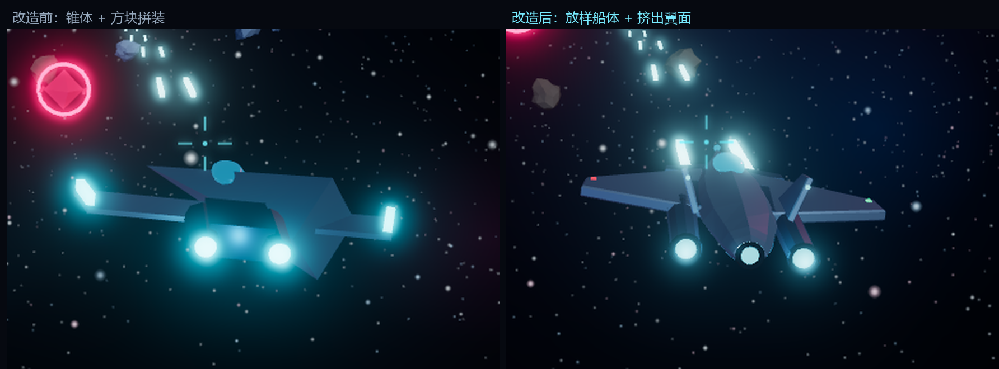

# 星际射击游戏 · 开发方案

> 配套代码：本仓库（可直接 `npm run dev` 玩一局，约 1400 行）
> 文档目的：回答「怎么科学地做出来」「用 Three.js 还是 Blender」，并给出一条能落地的路线。

---

## 0. 先纠正问题本身

**Three.js 和 Blender 不是二选一，它们不在同一层。**

| 层 | 工具 | 负责什么 | 在你的项目里 |
|---|---|---|---|
| **运行时 / 引擎** | Three.js | 渲染管线、输入、主循环、碰撞、后处理、资源加载 | **主战场**，90% 的开发时间在这里 |
| **资产生产（DCC）** | Blender | 建模、UV、骨骼动画、法线/贴图烘焙 | **可选插件**，随时可以后置 |
| 工程化 | Vite + npm | 开发服务器、HMR、打包、依赖管理 | 已配好 |

一句话判断法则：

> **能用代码描述出来的形状，就别开 Blender；只有当「它必须看起来像一个真实物体」时才需要 DCC。**

这个仓库就是那条法则的证明：飞船、陨石、敌方无人机、星空、星云、爆炸、音效，**全部由代码程序化生成**，一个 `.glb` 都没有，零美术资源，整个 dist 只有 160 kB（gzip）。

---

## 1. 什么时候真的需要 Blender

不是「做 3D 游戏就要用 Blender」，而是遇到下面这些情况才必须上：

| 需求 | 程序化几何够用吗 | 是否上 Blender |
|---|---|---|
| 原型期验证玩法、手感 | ✅ 够用（锥体+方块拼一艘船，20 分钟） | ❌ 不要，会拖慢 10 倍 |
| 主角飞船要有辨识度、有磨损细节 | ⚠️ 极限了 | ✅ 低模 3–8k 面 + 法线烘焙 |
| 敌人/BOSS 有骨骼动画、变形 | ❌ | ✅ 必须 |
| 需要 PBR 材质（金属划痕、发光条纹） | ⚠️ 只能靠纯色+自发光 | ✅ 烘焙贴图 |
| 场景道具（空间站、残骸） | ⚠️ 拼得出来但很假 | ✅ |
| 2D UI / HUD / 图标 | — | ❌ 用 CSS + SVG |

**关键判断：先用程序化几何把「游戏好不好玩」验证完，再决定要不要花钱做资产。** 很多新手死在「先花两周做飞船模型，然后发现玩法不好玩」。

---

## 2. 「科学」开发 = 把主观问题变成可测量的问题

游戏开发最容易失控的地方是「手感」和「好玩」。科学的做法不是玄学，是把它拆成**可以被测量、被复现、被对比**的东西。

### 2.1 先写成功指标（在写第一行代码之前）

本项目的真实指标：

| 维度 | 指标 | 为什么是这个数 |
|---|---|---|
| 帧率 | 1080p 集显 ≥ 60 FPS | 射击游戏 < 60 帧直接不可玩 |
| 帧预算 | 每帧 ≤ 16.7 ms，其中 JS ≤ 3 ms | 给渲染和浏览器留够余量 |
| Draw call | ≤ 200（本项目常态 30–60） | 超过 300 开始成为瓶颈 |
| 三角面 | ≤ 25 万（本项目 < 3 万） | 移动端/集显的舒适区 |
| 首爽点 | **开局 30 秒内必须发生第一次击杀** | 这条指标直接改掉了初版设计（见 2.4） |
| 包体 | ≤ 3 MB（gzip） | 网页游戏的加载耐心上限 |

### 2.2 垂直切片（Vertical Slice）优先于内容量

不要先做「10 种敌人、5 张地图」的框架，先做**一条完整链路**：

```
进入 → 操控 → 射击 → 命中反馈 → 击杀 → 分数 → 受伤 → 死亡 → 重开
```

这条链路里每一环都做到 80 分，再横向复制内容。本项目就是这个切片：1 种玩家机、2 种敌人、无限波次、完整死亡/重开闭环。

### 2.3 手感参数外置 + 实时热调

手感不是「调出来的灵感」，是**参数空间里的一个点**。所以：

- 所有会反复改的数值集中在 [`src/config.js`](../src/config.js)，逻辑代码里不出现魔法数字；
- 用 lil-gui 把它们暴露成滑杆（游戏里按 `G` 显示/隐藏）；
- 调到满意后**手动回填默认值**，并在提交信息里记下「为什么是这个值」。

这样做的收益：调一次手感从「改代码 → 等编译 → 刷新 → 试」变成「拖滑杆」，迭代速度差 10 倍。

### 2.4 用「可复现」对抗玄学

- **自适应子步长**：每帧把 `dt` 切成若干「≤ 1/60 秒」的小步推进模拟，渲染有多少帧就推进多少时间。
  早期版本用的是「固定 1/120 步长 + 累加器」，在 60Hz 下没问题，但在 144Hz/75Hz 屏幕上会一帧走 1 步、下一帧走 0 或 2 步 —— 表现就是**不做任何操作机身也在抖**。固定步长换来的可复现性，抵不过这种全天候的抖动。
- **不做追帧**：切标签页回来把 `dt` 钳到 0.1 s，直接丢弃多余时间（否则会瞬移穿模）。
- **一次只改一个变量**：想验证「弹速 260 是不是太快」，就只改弹速，其他锁死。

> 真实案例：初版开局是空场，陨石从 -165 米处生成，要飞 5 秒才到眼前——前 5 秒玩家没事可做，直接违反「30 秒首爽点」指标。
> 修法：`Game.reset()` 里预铺 7 块陨石，其中最近的就在 45 米外（见 [game.js](../src/game/game.js)）。

---

## 3. 架构：分层 + 单向依赖

```
src/
├── config.js          所有可调参数（唯一真相源）
├── main.js            启动、主循环（固定步长）、调参面板
├── core/
│   └── input.js       设备 → 意图（键鼠/触屏/手柄的唯一适配点）
├── gfx/
│   ├── stage.js       渲染器、相机、灯光、后处理、环境光
│   ├── starfield.js   星空 + 星云（1 次 draw call）
│   ├── textures.js    程序化贴图（canvas 生成，无资源文件）
│   ├── bullets.js     子弹对象池（InstancedMesh）
│   └── fx.js          粒子爆炸 / 冲击波 / 瞬时点光（全池化）
├── game/
│   ├── game.js        状态机、波次导演、碰撞裁决
│   ├── player.js      战机模型 + 弹簧阻尼操控
│   └── enemies.js     陨石（InstancedMesh）+ 无人机（少量独立对象）
├── ui/
│   └── hud.js         纯 DOM 覆盖层
└── audio.js           WebAudio 程序化音效
```

**依赖只能向下**：`game` 不 import `gfx` 的实现细节，`gfx` 不知道 `game` 存在。
好处是换渲染方案（比如以后上 WebGPU）时，玩法代码一行都不用改。

### 3.1 性能手段（都不是玄学，是预算）

| 手段 | 位置 | 解决什么 |
|---|---|---|
| 自适应子步长（每步 ≤ 1/60s） | `main.js` | 任意刷新率下位移连续，机身不抖 |
| InstancedMesh | 子弹 250 发、陨石 34 块 | 250 次 draw call → **1 次** |
| 对象池（零 `new`） | `bullets.js` / `fx.js` | 运行期不产生垃圾，避免 GC 造成的卡顿尖峰 |
| 逐点颜色衰减代替透明度 | `fx.js` | `PointsMaterial` 不支持逐粒子 alpha，用颜色乘子模拟 |
| 只在数值变化时写 DOM | `hud.js` | 避免每帧 60 次样式重排 |
| `frustumCulled = false` | 星场/实例网格 | 这些对象本来就一直可见，省掉无用的视锥计算 |
| 后处理用 HalfFloat + 4x MSAA RT | `stage.js` | Bloom 需要 HDR，同时保住边缘 |

HUD 右下角实时显示 `FPS · DrawCall · 三角面`，这是性能预算的第一道哨兵——**不测量就不要优化**。

---

## 4. 手感是怎么「算」出来的

玩家的操控不是 `position.lerp(target, 0.1)`，而是一个**质量-弹簧-阻尼系统**：

```
a = k · (mouse - pos) − c · v
v += a · dt
pos += v · dt
```

- `k` = 跟随刚度（弹簧多硬）
- `c` = 阻尼（多快停下来）
- 临界阻尼条件 `c ≈ 2√k`

本项目 `k = 110`，临界阻尼约 21，实际取 `c = 16` → **刻意做成欠阻尼**（比值 0.76），表现为「跟手但会轻微过冲一点点」，这是射击游戏想要的「有速度感但不飘」。

为什么不用 lerp：
- lerp 的跟随速度与距离成正比，远距离时慢、近距离时黏，手感不均匀；
- 弹簧模型有明确的物理意义，任何一个参数都能被解释，而不是「试到这个数感觉还行」。

**结论：可解释的参数 > 玄学调参。**

---

## 4.5 360° 飞行与多端输入

射击游戏「像不像在开飞机」，一半在飞行模型，一半在相机。项目里这两块是分开的：

### 4.5.1 飞行模型：在机体坐标系里积分姿态

姿态用**四元数**，不用欧拉角（欧拉角在俯仰 ±90° 附近会万向节死锁，翻不了筋斗）。每步：

```
angVel → 目标角速度（由输入决定，pitch/yaw/roll 各一路）
angVel += (target - angVel) * (1 - e^(-response*dt))     // 阻尼跟随，不是硬切
dq = quat(angVel * dt)                                    // 机体坐标系下的增量
q  = q * dq                                               // 右乘 = 局部旋转
pos += forward(q) * speed * dt
```

三个细节决定「手感」：

| 细节 | 做法 | 为什么 |
|---|---|---|
| 转向不是瞬时的 | 角速度用指数阻尼逼近目标值 | 硬切会像鼠标转视角，没有机身惯性 |
| 转弯自动压坡度 | `roll += yaw * bankFromYaw` | 飞机转弯是「侧倾 + 拉杆」，不侧倾像在贴地平移 |
| 机头即前进方向 | 速度沿 local -Z | 这才是「飞机」，不是「能转的滑板」 |

### 4.5.2 追尾相机：位置和朝向都从机体推导

```
camPos = shipPos + (0, 2.7, 15.5) 经四元数旋转
camUp  = shipUp 与世界上方按 rollFollow 混合
camQ   = lookAt(camPos, shipPos + forward*18, camUp)
```

- 位置/朝向都做指数阻尼 → 跟随有滞后，转弯才有「甩尾」的重量感；
- `rollFollow = 0.82` 是刻意的：完全跟随横滚，机身相对画面永远水平，玩家看不出自己在滚；完全不跟随，倒飞时画面不跟着转，会晕。取 82% 是折中。

### 4.5.3 输入抽象：三套设备 → 一个意图

```
键盘 (WASD/方向键)  ┐
鼠标 (指针锁定增量) ├→  steer{x,y} + roll + fire + boost  →  飞行模型
触屏 (浮动摇杆)     ┘
```

玩法层只读意图，永远不碰事件对象。好处：
- 加手柄只要在 `Input` 里加一路；
- 可以做「AI 演示 / 自动巡航」——直接写意图即可；
- 移动端和 PC 共用同一套飞行参数，手感不会分裂。

**移动端布局参考了主流手游射击的成熟方案**（PUBG Mobile / CODM）：

| 方案 | 为什么这么设计 |
|---|---|
| **左半屏浮动摇杆** | 手指按下的位置就是摇杆原点，不用低头找固定圆圈 |
| 右侧大按钮开火 | 拇指自然落点，持续按住 = 连发 |
| 右半屏任意处按下也能开火 | 不用精确命中按钮，减少误触成本 |
| 加力单独一颗 | 冲刺是「战术动作」，需要独立按键而不是摇杆推到底 |
| `touch-action: none` | 否则移动端会触发滚动/缩放，摇杆直接失灵 |

> 判定 `(pointer: coarse)` 才显示触控层，桌面不会出现一堆按钮；`?touch=1` 可强制开启，方便在桌面调试触控布局。

---

## 4.6 道具、背景、障碍：三个容易做错的地方

### 4.6.1 道具要"飞过去吃"，不能白给

在 360° 飞行里，道具如果刷在身后或自动拾取，就失去了意义。正确的做法是：**刷在机头前方，让玩家用一次航向调整去换它**。

| 道具 | 时长 | 玩法作用 | 实现要点 |
|---|---|---|---|
| 无敌 | 4.5s | 硬闯碎石带 | 伤害入口处短路（`damage()` 直接 return），不是扣血后再加回来 |
| 反弹 | 6s | 把敌方弹幕变成资源 | 命中的敌弹原地转成玩家子弹，速度反向并自动索敌最近敌人 |
| 修复 | 瞬时 +30 | 续航 | 满了就停止掉落（避免"道具白给"） |

**关键：状态计时放在玩家身上（`player.invincible` / `player.reflect`），而不是道具上。** 这样"吃第二个无敌"只是刷新计时，不会出现两个 buff 叠加的边界情况。

### 4.6.2 背景天球：跟平移，不跟旋转

远景天体在"无限远"，所以：

```
✅ 每帧 group.position = 玩家位置     （没有视差，永远不会被飞走）
✅ group.rotation 保持世界固定        （转身时它会正确地移出视野）
❌ 挂在相机下面                       （转身时它会黏在屏幕上，一眼假）
```

两个细节：
- **切换时把新景观摆到视线侧前方**。天球重新定向是看不出来的，但随机方向很可能落在背后 —— 玩家永远看不到你辛苦画的黑洞。
- **黑洞的"黑"画不出来**。加法混合里黑色等于透明，所以视界必须再叠一块纯黑圆盘（普通混合）去遮挡背景星星，否则黑洞中心会漏星星，瞬间出戏。

### 4.6.3 障碍物分型：一类一个 InstancedMesh

加种类几乎不花性能预算：岩石 / 冰晶 / 晶簇各自一个 `InstancedMesh`，每个仍然只有 **1 次 draw call**。三者的几何（扰动二十面体 vs 尖八面体）、材质（粗糙 / 半透明 / 自发光）、数值（血量、伤害、分值）都不同，玩家一眼能分辨该打还是该绕。

> 判据：**视觉上要能区分"威胁等级"**，而不只是"长得不一样"。冰晶脆、晶簇硬，玩家会自然形成优先级。

### 4.6.4 把「背景」变成「目的地」

背景天球再好看也只是壁纸。想让太空有**方向感**，必须再放一层**世界坐标里的地标**：

| | 背景天球（Backdrop） | 地标（Landmark） |
|---|---|---|
| 位置 | 跟玩家平移，永远无限远 | 世界坐标里的真实位置 |
| 作用 | 氛围、色彩 | **目标**：飞过去会发生事 |
| 代价 | 几乎为零 | 要 3D 几何 + 导航 HUD + 状态机 |

本项目的地标是两种（距离用**光年**显示，1 光年 = 2000 世界单位）：

- **黑洞**：视界球（纯黑、会遮挡星星）+ 倾斜吸积盘 + 光子环。飞进 120 单位触发「穿越」：锁操作 → 速度被拉到 260 → 白闪 → 传到 3200 单位外、清场、换天、星区 +1。
- **银河**：6000 颗螺旋分布的粒子，**是真的可以飞进去的**，核心有辉光。进入半径 300 单位。

每个星区长度约 **1.8 光年**（≈3600 单位，巡航约 60 秒、全程加力约 35 秒），中间正好打 2–3 波敌人。

三个必须做的配套：
1. **屏幕边缘的导航箭头 + 距离**。没有它，玩家永远找不到地标（尤其是 360° 飞行时）。
2. **掉队重投**：被甩到身后 2.8 光年就把地标重新放到机头前方，避免"永远追不上"。
3. **天上别放同款**：地标是黑洞/银河时，天空只允许出现星云。否则画面里会出现"黑洞叠在银河上"——玩家第一反应是"这里出 bug 了"，而不是"好壮观"。

两个只有把"天空变成目的地"才会踩到的坑：

- **相机远平面**：地标在 3600 单位外，而相机 far 还是 1600 时，它会被直接裁掉。远平面必须按世界尺度重新给（现在 20000，near 也相应抬到 0.8 保住深度精度）。
- **背景天球的绘制顺序**：天球原本是"透明 + 加法混合"，会进透明队列，在所有不透明物体之后绘制 —— 结果就是它把黑洞的视界球照亮，黑洞不黑。改成「不透明材质 + 加法混合 + renderOrder = -1000」，让它进不透明队列并排在最前，视界球就能正确遮挡它；淡入淡出改为对颜色乘系数（不透明材质改 opacity 是无效的）。

---

## 5. Blender 进场后的资产管线

真到了要上美术的阶段，按这个顺序做，能把返工率降到最低：

### 5.0 先用代码把「造型」推到极限

很多新手以为「不用 Blender 就只能拼方块」，其实程序化建模有三个层次，效果差距极大：

| 层次 | 手法 | 效果 |
|---|---|---|
| L1 拼装 | `Cone` + `Box` + `Sphere` 直接摆 | 像纸飞机，一眼假 |
| L2 放样 | 沿轴给一组横截面，逐环连成皮肤（`loftHull`） | 有棱线的机身，像隐身战机 |
| L3 挤出 | `Shape` 画平面图 → `ExtrudeGeometry` 加倒角 | 有厚度、边缘有高光的真实翼面 |



同样的工作量，L1 → L3 只多写了 100 行代码（见 [`src/game/shipModel.js`](../src/game/shipModel.js)），但视觉档次完全不同。
**结论：在动 Blender 之前，先把放样和挤出这两招用尽。**

### 5.1 导出规范（先定规范，再动手建模）

| 项 | 规范 | 原因 |
|---|---|---|
| 单位 | 1 Blender unit = 1 米 | 和物理参数（速度 m/s）对齐 |
| 朝向 | 模型正面朝 **−Z**，Y 轴向上 | Three.js 相机看 −Z，省掉运行时旋转 |
| 原点 | 放在质心，不要放在世界原点 | 旋转/受力才正常 |
| 三角面 | 单艘战机 ≤ 8k，陨石 ≤ 500 | 移动端预算 |
| 材质 | 1 个模型 ≤ 2 个材质槽 | 每个材质槽 = 1 次 draw call |
| 命名 | `SM_`(静态) / `SK_`(骨骼) / `MI_`(实例) | 后期批处理靠它 |
| 格式 | **glTF 2.0 (.glb)** + Draco 压缩 | 网页原生格式，Three.js 一等支持 |

### 5.2 加载

```js
import { GLTFLoader } from 'three/addons/loaders/GLTFLoader.js';
import { DRACOLoader } from 'three/addons/loaders/DRACOLoader.js';

const draco = new DRACOLoader().setDecoderPath('/draco/');
const gltf = await new GLTFLoader().setDRACOLoader(draco).loadAsync('/models/ship.glb');
player.model.add(gltf.scene);
```

**注意：`gfx/` 层只负责「把模型放上去」，玩法层不应该知道这个模型是程序化生成的还是 Blender 导出的。** 这就是分层的价值——替换资产不动逻辑。

### 5.3 从程序化到美术的替换顺序

1. **主角飞船**（玩家 90% 时间在看它，回报最高）
2. **敌人**（需要辨识度，越往后越花）
3. **场景道具**（影响最小，最后做）
4. **特效**（粒子/拖尾通常继续用程序化，比做贴图序列更灵活）

---

### 5.5 用 ComfyUI 出游戏素材：什么该交给 AI，什么不该

本地 ComfyUI（Qwen-Image 2.1 Turbo，8 步 / CFG 1.0，约 8–15 秒一张）在本项目里只干了三件事，因为这三件事**AI 的投入产出比最高**：

| 用途 | 理由 | 产物 |
|---|---|---|
| **天球背景** | 画幅大、细节多、程序化画不出那种质感；而且是 2D 贴图，不需要 UV | `bg_galaxy` / `bg_blackhole` / `bg_nebula` |
| **表面贴图** | 岩石/冰/晶体的微观质感，代码写不出来 | `tex_rock` / `tex_ice` / `tex_crystal` |
| **图标 / 插画** | 纯 2D，一次出图直接可用 | `icon_*` / `menu_art` |

**不该交给 AI 的**：3D 模型本身。生成的图没有拓扑、没有 UV、没有法线 —— 除非你上「图生 3D」专用模型。

> 但 3D 资产也不一定要手工建。本项目的敌机和补给胶囊是**用 Blender 的 Python 脚本生成**的
> （`tools/blender_assets.py`，`blender -b -P` 无头跑，一条命令重建全部模型）。
> 脚本化的好处：尺寸/配色/部件都在代码里，改一个参数重跑就是新版本，而且天然可版本管理。
> 适合"几何体拼得出来、但比手搓 three.js 好看得多"的中间地带 —— 大部分敌人、道具、场景件都在这个区间。

> 本项目实测过这条路：Qwen-Image-Edit 出多角度三视图 → Hunyuan3D 2.0（单视图）→ GLB → 游戏。
> 结论是**能用，但别指望一次到位**：
> - 4.6 GB 权重、30 步采样，单张图 2–4 分钟出一套 247k 面的网格；
> - 单视图重建的轮廓偏"软"（voxel 256 的固有限制），细节靠贴图补不回来；
> - 想要硬朗的硬表面，应该上 **multiview 模型**（`hunyuan3d-dit-v2-mv`）喂四张视图，而不是继续调单视图参数。
>
> 所以正确的定位是：**AI 负责"设计探索"（出概念、出三视图），3D 资产要么走 multiview 重建 + 人工修，要么直接进 Blender 按三视图建低模。**

三个工程上的坑（都踩过）：

1. **纯黑底的图标**：模型不会给你透明通道，所以约定「纯黑背景 + `mix-blend-mode: screen`」，黑自动变透明，省掉抠图。
2. **背景图要压暗**：AI 图细节和亮度都高，直接把 `opacity` 拉到 1 会盖过弹道和敌机。本项目给 AI 背景单独一个 `maxOpacity = 0.7`。
3. **必须能缺图运行**：`assets.js` 里每张图独立加载、失败静默跳过，缺图自动退回程序化版本。否则别人 clone 下来没图就直接黑屏。

---

## 6. 里程碑路线（可按 12 周排）

| 阶段 | 时间 | 目标 | 验收标准 |
|---|---|---|---|
| M0 垂直切片 | 第 1 周 | 能玩的完整闭环 | 30 秒内首杀；60fps；死亡可重开 |
| M1 手感定稿 | 第 2 周 | 操控/射击/受击反馈定稿 | 3 个外行各玩 3 分钟，都说「跟手」 |
| M2 内容横向扩展 | 第 3–5 周 | 3 种敌人 + BOSS + 3 种武器 | 波次曲线能让玩家心率上升 |
| M3 资产替换 | 第 6–8 周 | Blender 低模替换占位几何 | draw call 不升反降（合并材质） |
| M4 音频/UI/存档 | 第 9–10 周 | 完整包装 | 无声玩和有声玩体验明显不同 |
| M5 优化与发布 | 第 11–12 周 | 性能、兼容、发布 | 低端安卓机 ≥ 30fps；包体 ≤ 3MB |

**每周必须有可玩产物。** 任何一周结束时不能玩，说明路线错了。

---

## 7. 这个项目里踩过的坑（都是真实的）

| 坑 | 现象 | 原因 | 解法 |
|---|---|---|---|
| 引擎光吃掉机身 | 飞船变成一团白光 | 加法混合的 Sprite 尺寸过大 + Bloom 阈值太低 | 缩小光斑、阈值提到 0.72、降低曝光 |
| 金属材质变成黑剪影 | 敌机只剩一个红圈 | `metalness` 高的材质没有环境贴图时**没有东西可反射** | 程序化生成等距柱状环境图 + PMREM |
| 陨石像保龄球 | 正二十面体太圆 | 几何体本身是规则多面体 | 用**确定性函数**扰动顶点（不能用随机数，否则共享顶点会被撕开） |
| 开局 5 秒没事干 | 玩家以为游戏卡了 | 敌人生成距离太远 | 预铺 7 块陨石在 45–165 米处 |
| 切标签页回来瞬移 | 敌机穿身而过 | 累积了巨大 dt | `dt` 上限 0.25s + 最大 8 个步进，超了直接丢弃 |

---

## 8. 什么时候**不该**用 Three.js

诚实说清楚边界：

| 你的情况 | 建议 |
|---|---|
| 网页/Electron、2–5 人小团队、快速验证玩法 | **Three.js 是最短路径** |
| 要上主机（PS/Xbox/Switch） | Unity / Unreal |
| 需要重度物理（破坏、载具、布娃娃） | Unity（PhysX）/ Godot 4 |
| 需要多人联机同步 | Unity + Netcode / Godot 高层网络 |
| 大世界地形、植被、Lumen 级光照 | Unreal |
| 纯 2D 小游戏 | Phaser / Godot，别用 Three.js 硬扛 |

Three.js 不是游戏引擎，它没有编辑器、没有内置物理、没有资源管线——**它给你的是渲染和数学**。所以它适合「你愿意自己写一点框架」的团队，不适合「要开箱即用」的团队。

---

## 9. 下一步（如果继续做）

1. 手感定稿：把 lil-gui 里的参数拖动到满意，回填 `config.js`，删掉不用的滑杆；
2. 加 **BOSS 战**：一个会分阶段变招的目标，是波次玩法的节奏高点；
3. 加 **武器系统**：散射/激光/导弹，用同一套 `BoltPool` 加参数区分；
4. 上 **Blender 主角机**：按第 5 节的规范做一个 5k 面的低模，替换 `player.js` 里的拼装几何；
5. 加 **排行榜/分享**：网页游戏最大的优势是传播，记分板是留存的第一步。

---

*本文档中的每个数字都来自本仓库的实际代码，可以直接对照 [src/config.js](../src/config.js) 验证。*
